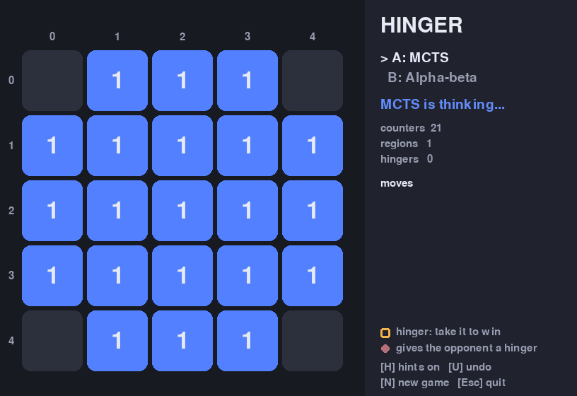
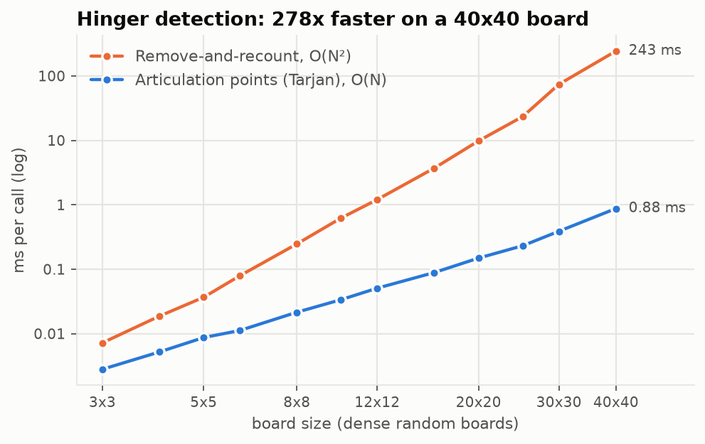
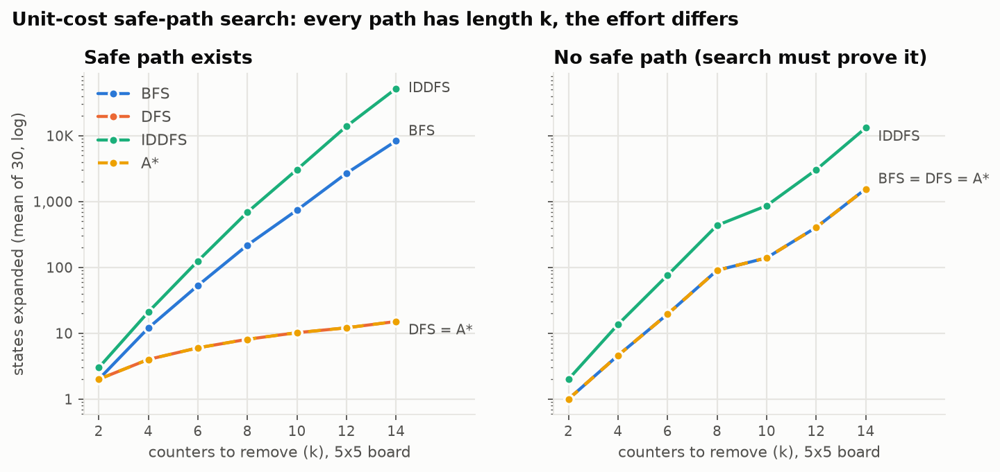
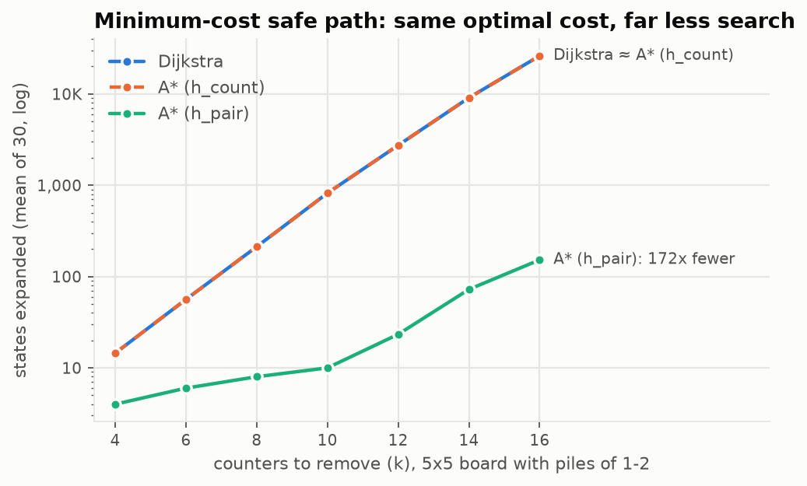
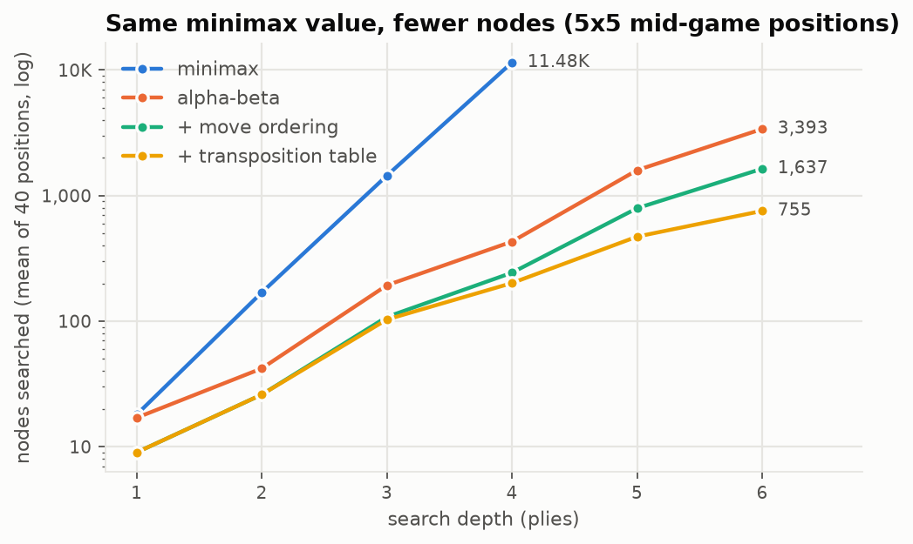
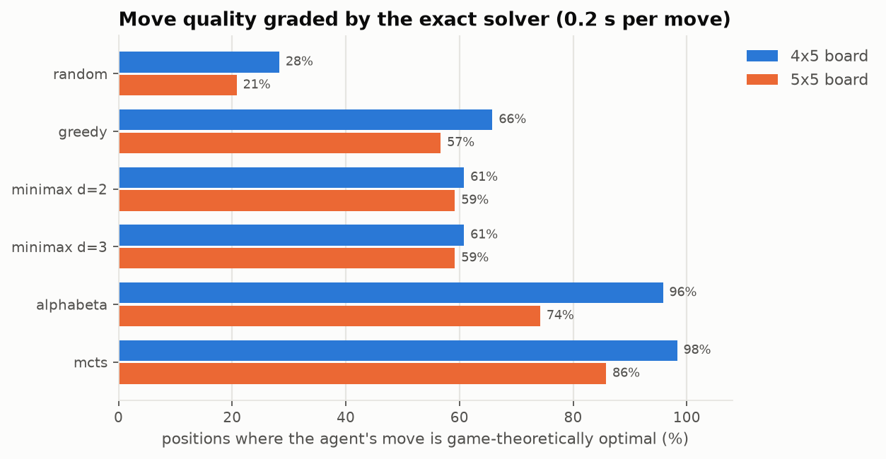
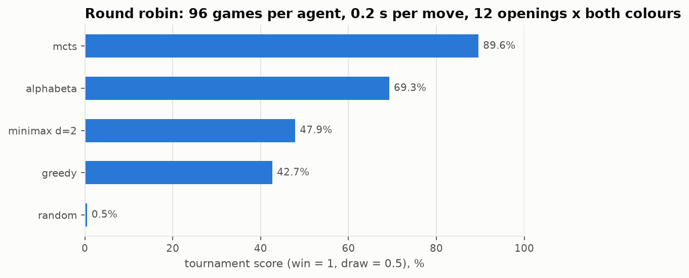

<h1 align="center">Hinger AI: search, solving and game-playing agents</h1>

<p align="center">
  <b>English</b> &nbsp;|&nbsp; <a href="README.zh-CN.md">简体中文</a>
</p>

<p align="center">
  <a href="https://github.com/cpg25ncu/hinger-ai/actions/workflows/ci.yml"></a>
  
  
  <a href="LICENSE"></a>
</p>

Classical AI for **Hinger**, a two-player combinatorial board game: graph
algorithms for the rules, uninformed and informed search for safe paths, an exact
game solver, and minimax, alpha-beta and Monte Carlo tree search players, all
measured against each other. The engine uses the **Python standard library only**;
pygame is an optional extra for the desktop GUI.

<p align="center"></p>
<p align="center"><sub>MCTS (A) vs alpha-beta (B) in the GUI with hints on: amber outlines are hingers (take one to win), red dots are moves that would hand the opponent a hinger.</sub></p>

> **Background.** This started as a three-person group coursework for an
> undergraduate AI module at the University of East Anglia (2025–26), in which I
> wrote the implementation. I later rebuilt it from scratch as a tested package and
> extended it well beyond the brief: linear-time hinger detection, a new admissible
> heuristic, an exact solver, MCTS, a GUI and the benchmarks below. On the same
> depth-4 alpha-beta search of the full 4×5 board, the original submission took
> 10.2 s and the rebuilt engine takes 37 ms.

## Highlights

| | |
|---|---|
| **278× faster hinger detection** | A hinger is exactly an *articulation point* of the board graph holding one counter, so one O(N) Tarjan pass replaces N region recounts (0.88 ms vs 243 ms on 40×40 boards). Cross-checked against brute force on thousands of random boards |
| **172× fewer states for minimum-cost paths** | A* with a pairwise lower bound I derived (`h_pair`, provably admissible and consistent) vs Dijkstra, same optimal cost. Exact on binary boards |
| **Search that knows the problem's shape** | The state space is a DAG with fixed depths, so dead states can be pruned (25–60× fewer BFS expansions) and every safe path has the same length. DFS and A* reach the goal in ~k expansions where BFS needs 8,300 and IDDFS 52,000 (k = 14) |
| **Exact solver** | Memoised negamax with symmetry reduction solves the full 5×5 board (352,675 positions, 20 s): the first player wins. 4×4, 4×5 and 4×6 are second-player wins |
| **MCTS is the strongest player** | 98 % optimal moves on 4×5 and 86 % on 5×5 at 0.2 s/move (graded by the solver), 90 % tournament score and 71 % against alpha-beta. Alpha-beta: 96 % / 74 %, 69 % |
| **Alpha-beta engineering** | Iterative deepening, transposition table, lazy safe-first ordering and dominated-move pruning: 755 nodes at depth 6 vs 3,393 for plain alpha-beta (4.5×), 2.2× faster |
| **Engineering** | One CLI (`play`, `gui`, `solve`, `path`, `replay`), JSON game records, 77 tests, CI on Python 3.10–3.13 |

## The game

The board is a grid of piles of counters. Cells touching horizontally, vertically
or diagonally are adjacent, and a connected group of non-empty cells is a
*region*. Players take turns removing one counter from any non-empty cell.

A **hinger** is a cell holding exactly one counter whose removal splits its region
in two or more. **Whoever removes a hinger wins.** If the board is cleared
without anyone doing so, the game is a draw. A move costs 1 plus the number of
non-empty neighbours of the cell, which matters for the minimum-cost path problem.

```
 1 1 0 0 2      The centre cells (1,1) and (2,2) are hingers: removing either
 1 1 0 0 0      cuts its region in two, so the player to move wins at once.
 0 0 1 1 1      The 2 at (0,4) is never a hinger; it is a pile of two counters.
 0 0 0 1 1
```

Two tasks are studied:

* **Safe paths.** Find a sequence of moves from one position to another such that
  no position on the way contains a hinger, optionally of minimum total cost.
* **Playing.** Choose moves that win against an opponent.

## How it works

### 1. Hinger detection in linear time ([`state.py`](src/hinger/state.py))

Every search and every agent asks "does this position contain a hinger?" millions
of times. The direct method removes each single-counter cell and recounts the
regions: O(N) recounts of O(N) each. But removing a vertex increases the number of
connected components exactly when it is an **articulation point**, so the hingers
are the articulation points holding one counter, and Tarjan's low-link algorithm
finds all of them in one O(N) DFS (written iteratively, so a 3,600-cell board does
not hit Python's recursion limit). States are immutable and hashable and cache
their hinger set, so a position is analysed at most once.

<p align="center"></p>

### 2. Safe-path search ([`search.py`](src/hinger/search.py))

Two properties of the state space drive the design:

* **It is a DAG with fixed depths.** Every move removes one counter, so a position
  can only be reached after `total(start) − total(position)` moves, by any route.
  No cycle checks are needed, and a visited set stays valid inside IDDFS.
* **Dead states can be pruned.** Counters are never added, so a cell already down
  to its goal count must not be touched. On binary boards this shrinks the space
  from every subset of the active cells to the 2^k states between start and goal
  (BFS: 25–60× fewer expansions for k = 4–6).

As a consequence **every safe path has the same length k**: BFS, DFS, IDDFS and A*
all return length-k paths, and the interesting question is effort. With unit
costs the heuristic "counters left to remove" is exact, so A*'s f-value is the same
for every node; breaking ties towards deeper nodes lets it run straight to the goal.

<p align="center"></p>

When a safe path exists, DFS and A* need about k expansions while BFS sweeps the
whole lattice level by level and IDDFS repeats that work at every depth. When none
exists, every complete method must exhaust the reachable space; then BFS, DFS and
A* tie, and DFS keeps a frontier about 5× smaller than BFS.

**Minimum-cost paths.** With real move costs (1 + active neighbours) A* needs a
better heuristic. The remaining cost splits into one unit per counter plus, for
every adjacent pair of cells, the removals at one cell made while the other is
still non-empty. With `d` = counters still to remove, each pair is bounded below:

| pair of adjacent cells in the goal | lower bound |
|---|---|
| both keep counters (always active) | `d_x + d_y` |
| only y keeps counters | `d_x` |
| both are emptied | `min(d_x, d_y)` (whichever empties first pays for every one of its removals) |

Summing these gives `h_pair`. It is admissible, and consistent because a move
lowers each pair term by at most one and in exactly those cases the move pays for
that neighbour. A side result: on binary boards the bound is **exact**. Of two
adjacent cells that are both cleared, exactly one pays for the other, so every
safe path costs the same; costs only differ once piles hold 2+ counters (an
optimal path then saves a median 4–7 % over an arbitrary safe path).

<p align="center"></p>

The simple "counters left" heuristic (`h_count`) is admissible too but gives
Dijkstra's search almost unchanged; `h_pair` cuts the mean from 26,143 to 152
expanded states at k = 16, with the same optimal cost (checked against brute force
in the tests).

### 3. Exact solver ([`solver.py`](src/hinger/solver.py))

If the position has a hinger, the player to move wins; an empty board is a draw;
otherwise the value is the best of the negated child values. The solver memoises
positions under a canonical form over the board's symmetry group (up to 8× fewer
entries on square boards) and stops at the first winning move.

| full board | result (perfect play) | positions | time |
|---|---|---|---|
| 2×n (n ≤ 8) | draw | ≤ 337 | < 0.1 s |
| 3×3, 3×5, 3×7 | first player wins | ≤ 19,736 | < 1 s |
| 3×4, 3×6, 3×8 | second player wins | ≤ 62,195 | 2.5 s |
| 4×4, 4×5, 4×6 | second player wins | 2,153 / 30,814 / 214,811 | 0.1 / 1.1 / 9.3 s |
| **5×5** | **first player wins** | **352,675** | **19.7 s** |

The solver also grades the agents below and answers `win(state)` exactly.

### 4. Game-playing agents ([`agents.py`](src/hinger/agents.py))

| agent | idea |
|---|---|
| `random`, `greedy` | baselines; greedy wins if it can and otherwise avoids handing over a hinger |
| `minimax` | full-width depth-limited negamax |
| `alphabeta` | alpha-beta + iterative deepening under a time limit, transposition table (with mate-distance scores), TT move first, lazy safe-first ordering, dominated-move pruning |
| `mcts` | UCT with *safe* rollouts: random moves that never create a hinger, and a hinger is taken when one appears |
| `solver` | perfect play (small boards) |

**Dominated moves.** A move that creates a hinger loses on the spot, the fastest
possible loss, so whenever a safe move exists those moves can be skipped without
changing the minimax value.

<p align="center"></p>

All variants return the same value at every depth (asserted in the benchmark). At
depth 4 alpha-beta with the extras searches 201 nodes where minimax needs 11,480;
at depth 6 the transposition table and ordering cut plain alpha-beta's 3,393 nodes
to 755. Ordering is generated lazily, because a child's hinger check is the
expensive part, and after a cut-off the remaining children are never checked.

**Why MCTS wins here.** Labelling 1,400 random positions with the solver shows the
strongest static feature is the *parity* of the counters left: the player to move
wins 75 % of positions with an odd number left but only 19 % of those with an even number. Parity cannot rank sibling moves,
though; every move removes one counter, so all leaves of a fixed-depth search
share it. Depth-limited alpha-beta therefore only sees forced results inside its
horizon, while MCTS rollouts estimate the outcome directly.

<p align="center"></p>
<p align="center"></p>

Head to head (score % of the row agent against the column agent, 24 games each):

| | mcts | alphabeta | minimax d=2 | greedy | random |
|---|---|---|---|---|---|
| **mcts** | | 70.8 | 93.8 | 93.8 | 100 |
| **alphabeta** | 29.2 | | 75.0 | 72.9 | 100 |
| **minimax d=2** | 6.2 | 25.0 | | 62.5 | 97.9 |
| **greedy** | 6.2 | 27.1 | 37.5 | | 100 |
| **random** | 0 | 0 | 2.1 | 0 | |

Alpha-beta is close to perfect on 4×5, where 0.2 s is enough to prove the result
of about 5 positions in 6, but falls behind MCTS on 5×5, where it proves fewer
than half.

## Quick start

```bash
git clone https://github.com/cpg25ncu/hinger-ai.git
cd hinger-ai
pip install -e ".[gui]"          # engine alone: pip install -e .

hinger gui                        # play against MCTS in a window (H = hints, U = undo)
hinger play -a human -b mcts      # the same in the terminal
hinger play --board full5x5 -a alphabeta -b mcts --think 0.5 --save game.json
hinger replay game.json
hinger solve 1111/1111/1111       # exact value and the value of every move
hinger path 1111/1111/1111 0110/1111/0110 --min-cost
```

Boards are presets (`cross`, `diamond`, `staircase`, `ring`, `piles`, `bars`,
`full4x4`, `full4x5`, `full5x5`), `random:RxC`, or rows separated by `/`. The
default board, `cross`, is a first-player win: can you find it against the AI?

As a library:

```python
from hinger import State, MCTSAgent, min_safe, play, win

s = State.parse("01110/11111/11111/11111/01110")
print(win(s))                                   # True: the first player can force a win
print(MCTSAgent(time_limit=0.5).choose(s))      # a move

start, goal = State.parse("2112/1221/2112"), State.parse("1111/1111/1111")
res = min_safe(start, goal)
print(res.path, res.cost, res.expanded)

result = play(s, MCTSAgent(time_limit=0.2), None)   # None = human at the terminal
result.save("game.json")
```

## Reproducing the results

```bash
pip install -e ".[bench,gui,dev]"
pytest -q
python benchmarks/bench_hinger.py        # hinger detection        ~1 min
python benchmarks/bench_search.py        # safe-path search         ~1 min (12 processes)
python benchmarks/bench_agents.py        # agents + tournament      ~4 min (12 processes)
python benchmarks/solve_boards.py        # solved boards            ~30 s
python benchmarks/make_figures.py        # figures from reports/tables/*.csv
python scripts/make_demo_gif.py          # the demo GIF (headless)
```

Benchmarks use fixed seeds. Node counts are deterministic; times and the
time-limited agents' results depend on the machine (here a 24-thread desktop CPU,
Windows 11, Python 3.12). The raw numbers are in [`reports/tables`](reports/tables).

## Project layout

```
src/hinger/
  state.py      board, rules, articulation-point hinger detection
  search.py     BFS, DFS, IDDFS, A*, min-cost A* (h_count, h_pair), Dijkstra
  solver.py     exact memoised negamax with symmetry reduction
  agents.py     random, greedy, minimax, alpha-beta, MCTS, solver agents
  game.py       game loop, illegal-move/time-limit handling, JSON records, replay
  gui.py        pygame front end (optional)
  cli.py        `hinger` command
  scenarios.py  preset boards and random problem generators
benchmarks/     scripts behind every table and figure
tests/          77 tests: brute-force cross-checks, optimality, agent/solver agreement, CLI
```

## License

MIT, see [LICENSE](LICENSE).
