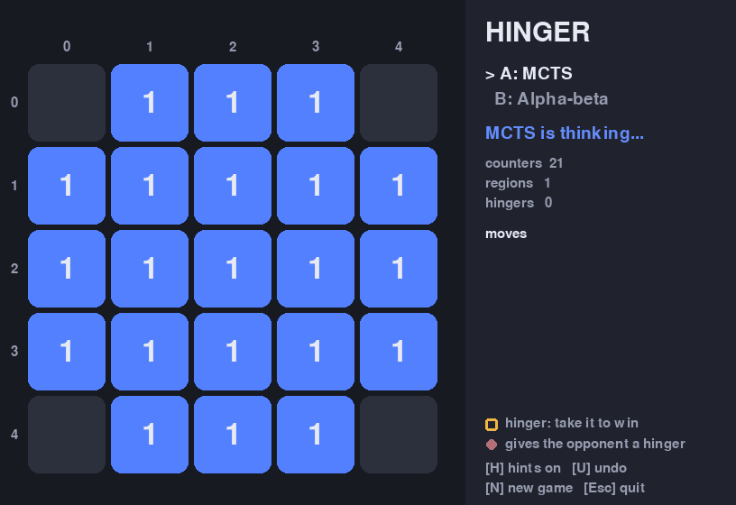
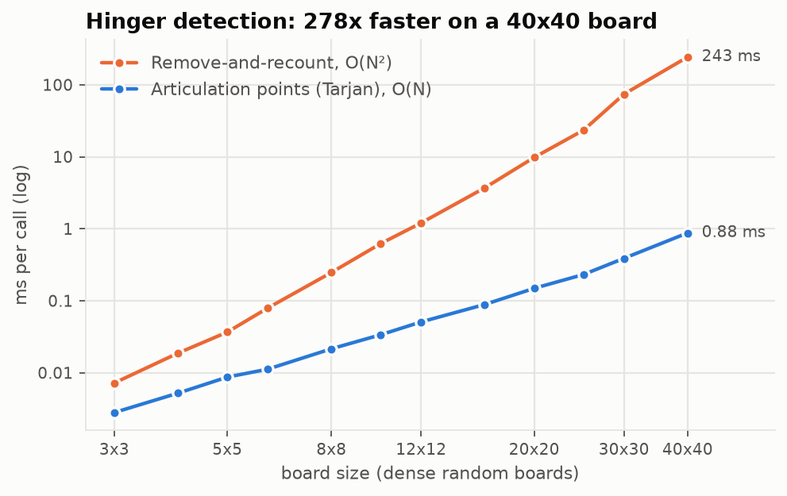
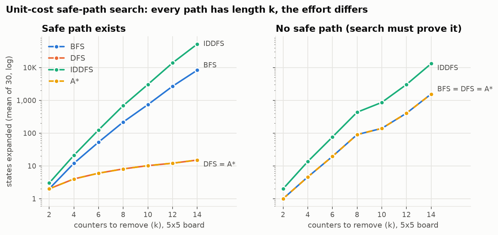
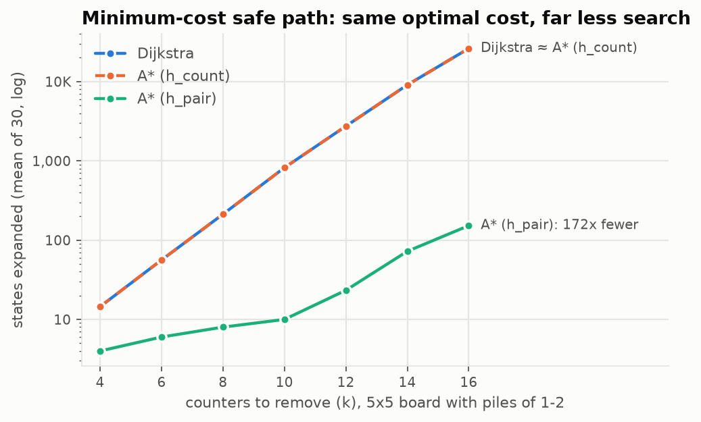
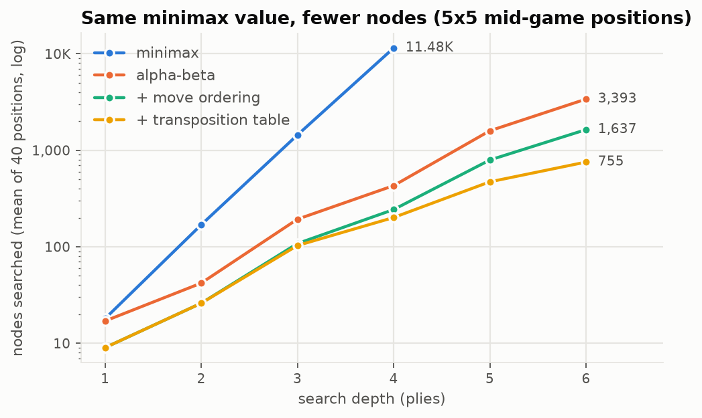
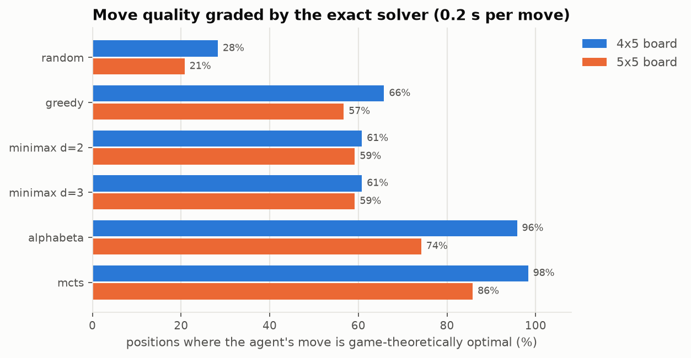
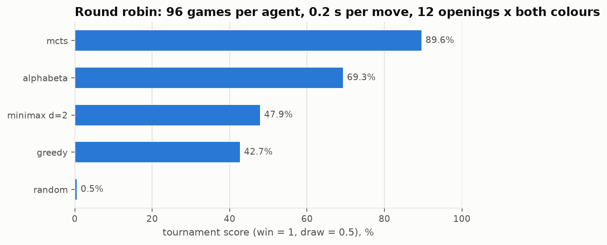

<h1 align="center">Hinger AI：搜索、求解与博弈智能体</h1>

<p align="center">
  <a href="README.md">English</a> &nbsp;|&nbsp; <b>简体中文</b>
</p>

<p align="center">
  <a href="https://github.com/cpg25ncu/hinger-ai/actions/workflows/ci.yml"></a>
  
  
  <a href="LICENSE"></a>
  <a href="https://github.com/cpg25ncu/hinger-ai/releases/latest"></a>
</p>

本项目为双人组合博弈 **Hinger** 实现了一整套经典 AI 方法：用图算法实现规则判定，用无信息搜索和启发式搜索求"安全路径"，一个精确的博弈求解器，以及 minimax、alpha-beta 和蒙特卡洛树搜索（MCTS）三类对弈智能体，并对它们做了系统的对比评测。引擎**只依赖 Python 标准库**，桌面图形界面用到的 pygame 是可选依赖。

<p align="center"></p>
<p align="center"><sub>图形界面中 MCTS（A）对阵 alpha-beta（B），已开启提示：琥珀色边框是 hinger（拿走即获胜），红点表示走这一步会把 hinger 送给对手。</sub></p>

> **背景。** 这个项目最初是东英吉利大学（UEA）本科人工智能课程的三人小组作业（2025–26 学年），代码实现由我完成。之后我把它从头重写成一个有完整测试的 Python 包，并做了远超作业要求的扩展：线性时间的 hinger 检测、一个新的可采纳启发式、精确求解器、MCTS、图形界面，以及下文的全部评测。同样在满盘 4×5 棋盘上做深度 4 的 alpha-beta 搜索，原提交版本需要 10.2 秒，重写后的引擎只需 37 毫秒。

## 亮点

| | |
|---|---|
| **hinger 检测快 278 倍** | hinger 恰好是棋盘图中只有一个棋子的*割点*，所以一次 O(N) 的 Tarjan 遍历就能取代 N 次重新数连通区域（40×40 棋盘上 0.88 ms 对 243 ms）。已在数千个随机棋盘上与暴力法逐一比对 |
| **最小代价路径少搜索 172 倍状态** | A* 使用我推导的成对下界启发式（`h_pair`，已证明可采纳且一致），与 Dijkstra 相比，得到的最优代价相同。在二值棋盘上该启发式是精确值 |
| **利用问题结构的搜索** | 状态空间是一个深度固定的 DAG，因此可以剪掉"死状态"（BFS 扩展数减少 25–60 倍），而且所有安全路径长度都相同。k = 14 时，DFS 和 A* 约 k 次扩展就到达目标，BFS 需要 8,300 次，IDDFS 需要 52,000 次 |
| **精确求解器** | 带对称性约简的记忆化 negamax 完整求解了 5×5 满盘（352,675 个局面，20 秒）：先手必胜。4×4、4×5、4×6 都是后手必胜 |
| **MCTS 是最强的玩家** | 每步 0.2 秒时，以求解器为标准答案，MCTS 在 4×5 上 98 % 的走法是最优的，5×5 上为 86 %；循环赛总得分 90 %，对 alpha-beta 得分 71 %。alpha-beta 对应为 96 % / 74 %，总得分 69 % |
| **alpha-beta 工程优化** | 迭代加深、置换表、惰性的"安全走法优先"排序、被支配走法剪枝：深度 6 时只搜索 755 个节点，朴素 alpha-beta 需要 3,393 个（少 4.5 倍），速度快 2.2 倍 |
| **工程化** | 统一命令行（`play`、`gui`、`solve`、`path`、`replay`），JSON 对局记录，77 个测试，在 Python 3.10–3.13 上跑 CI |

## 游戏规则

棋盘是一个网格，每格放着一堆棋子。横、竖、斜方向相邻的格子互为邻居，相互连通的非空格子构成一个*区域*。双方轮流从任意一个非空格子中拿走一枚棋子。

**hinger** 是指只有一枚棋子、拿走后会让所在区域分裂成两个或更多区域的格子。**谁拿走 hinger 谁就获胜。** 如果棋盘被拿空也没人拿到 hinger，则为平局。一步棋的代价等于 1 加上该格非空邻居的数量，这一点在最小代价路径问题中用到。

```
 1 1 0 0 2      中间的 (1,1) 和 (2,2) 都是 hinger：拿走任意一个都会把所在区域
 1 1 0 0 0      切成两半，所以轮到走棋的一方可以立即获胜。
 0 0 1 1 1      (0,4) 上的 2 永远不是 hinger，因为那是一堆两枚棋子。
 0 0 0 1 1
```

项目研究两个任务：

* **安全路径。** 找一串走法，从一个局面到达另一个局面，途中任何局面都不含 hinger；可选地要求总代价最小。
* **对弈。** 选择能赢下对手的走法。

## 实现原理

### 1. 线性时间的 hinger 检测（[`state.py`](src/hinger/state.py)）

所有搜索和智能体都要反复询问"这个局面里有没有 hinger"，调用次数以百万计。直接的做法是把每个单棋子格子拿掉后重新数区域：O(N) 次、每次 O(N) 的重新计数。而删除一个顶点会增加连通分量数，当且仅当它是**割点（articulation point）**。所以 hinger 就是只有一个棋子的割点，Tarjan 的 low-link 算法一次 O(N) 的 DFS 就能把它们全部找出来（这里用迭代实现，3,600 格的棋盘也不会触发 Python 的递归深度限制）。局面对象不可变、可哈希，并缓存自己的 hinger 集合，所以每个局面最多只分析一次。

<p align="center"></p>

### 2. 安全路径搜索（[`search.py`](src/hinger/search.py)）

设计依据的是状态空间的两个性质：

* **它是深度固定的 DAG。** 每一步都拿走一枚棋子，所以无论走哪条路线，到达某个局面都恰好需要 `total(start) − total(局面)` 步。不需要检测环，IDDFS 内部的访问集合也始终有效。
* **死状态可以剪掉。** 棋子只减不增，所以已经降到目标数量的格子不能再动。在二值棋盘上，这把搜索空间从"活跃格子的所有子集"缩小到起点与目标之间的 2^k 个状态（k = 4–6 时，BFS 的扩展数减少 25–60 倍）。

由此可知**所有安全路径的长度都是 k**：BFS、DFS、IDDFS 和 A* 返回的路径长度都是 k，真正要比较的是搜索开销。在单位代价下，启发式"还剩多少棋子要拿"是精确值，于是每个节点的 A* f 值都相同；把平局时的选择偏向更深的节点，A* 就能一路直达目标。

<p align="center"></p>

存在安全路径时，DFS 和 A* 大约只需扩展 k 个节点；BFS 要一层一层地扫完整个格，IDDFS 还要在每个深度上重复这些工作。不存在安全路径时，所有完备算法都必须穷尽可达空间，这时 BFS、DFS、A* 的扩展数相同，但 DFS 的边界（frontier）比 BFS 小约 5 倍。

**最小代价路径。** 使用真实的走法代价（1 + 非空邻居数）时，A* 需要更好的启发式。剩余代价可以拆成两部分：每拿一枚棋子算 1，再加上每对相邻格子之间"在一个格子上拿棋子时，另一个格子仍然非空"的次数。记 `d` 为还要拿走的棋子数，每对格子的下界如下：

| 目标局面中的一对相邻格子 | 下界 |
|---|---|
| 两格都保留棋子（始终非空） | `d_x + d_y` |
| 只有 y 保留棋子 | `d_x` |
| 两格都被清空 | `min(d_x, d_y)`（先被清空的那一格，它的每一次拿取都要为另一格付代价） |

把这些下界加起来就得到 `h_pair`。它是可采纳的；它也是一致的：一步棋最多让每个成对项减少 1，而在会减少的情况下，这一步恰好要为那个邻居付代价。一个附带结论：在二值棋盘上这个下界是**精确的**。两个相邻格子都要清空时，恰好有一个要为另一个付代价，所以所有安全路径的代价都相同；只有当一堆有 2 枚以上棋子时代价才会不同（此时最优路径比任意一条安全路径的代价中位数低 4–7 %）。

<p align="center"></p>

简单的"剩余棋子数"启发式（`h_count`）同样可采纳，但和 Dijkstra 相比几乎没有改进；k = 16 时，`h_pair` 把平均扩展状态数从 26,143 降到 152，最优代价不变（测试中已与暴力枚举对照验证）。

### 3. 精确求解器（[`solver.py`](src/hinger/solver.py)）

局面里有 hinger，则轮到走棋的一方获胜；棋盘为空，则为平局；否则局面值取各子局面取负后的最大值。求解器按棋盘对称群下的规范形式来记忆局面（正方形棋盘上表项最多减少 8 倍），并且一找到必胜走法就停止搜索。

| 满盘 | 双方都完美时的结果 | 局面数 | 用时 |
|---|---|---|---|
| 2×n（n ≤ 8） | 平局 | ≤ 337 | < 0.1 秒 |
| 3×3、3×5、3×7 | 先手必胜 | ≤ 19,736 | < 1 秒 |
| 3×4、3×6、3×8 | 后手必胜 | ≤ 62,195 | 2.5 秒 |
| 4×4、4×5、4×6 | 后手必胜 | 2,153 / 30,814 / 214,811 | 0.1 / 1.1 / 9.3 秒 |
| **5×5** | **先手必胜** | **352,675** | **19.7 秒** |

求解器还用来给下面的智能体打分，并精确回答 `win(state)`。

### 4. 对弈智能体（[`agents.py`](src/hinger/agents.py)）

| 智能体 | 思路 |
|---|---|
| `random`、`greedy` | 基线；greedy 能赢就赢，否则避免把 hinger 送给对手 |
| `minimax` | 全宽度、限深的 negamax |
| `alphabeta` | alpha-beta + 有时间限制的迭代加深、置换表（含按距离修正的胜负分）、置换表最佳走法优先、惰性的安全走法优先排序、被支配走法剪枝 |
| `mcts` | UCT，使用*安全*随机模拟：随机走法从不制造 hinger，一旦出现 hinger 就拿走 |
| `solver` | 完美对弈（仅限小棋盘） |

**被支配走法。** 制造 hinger 的走法会让自己当场输掉，这是最快的输法。所以只要还有安全走法，这些走法就可以直接跳过，minimax 值不会改变。

<p align="center"></p>

所有变体在每个深度上返回的值都相同（评测脚本中有断言检查）。深度 4 时，带全部优化的 alpha-beta 只搜索 201 个节点，minimax 需要 11,480 个；深度 6 时，置换表和走法排序把朴素 alpha-beta 的 3,393 个节点减少到 755 个。走法排序是惰性生成的，因为生成子节点时 hinger 检查才是开销大头，发生剪枝后剩下的子节点根本不会被检查。

**为什么这里 MCTS 最强。** 用求解器给 1,400 个随机局面打标签后发现，最强的静态特征是剩余棋子数的*奇偶性*：剩余奇数枚时，轮到走棋的一方赢下 75 % 的局面；剩余偶数枚时只赢 19 %。但奇偶性无法区分兄弟走法：每一步都拿走一枚棋子，固定深度搜索的所有叶节点奇偶性都相同。因此限深的 alpha-beta 只能看到视野内的必胜或必败，而 MCTS 的随机模拟能直接估计最终结果。

<p align="center"></p>
<p align="center"></p>

两两对战（行智能体对列智能体的得分 %，每组 24 局）：

| | mcts | alphabeta | minimax d=2 | greedy | random |
|---|---|---|---|---|---|
| **mcts** | | 70.8 | 93.8 | 93.8 | 100 |
| **alphabeta** | 29.2 | | 75.0 | 72.9 | 100 |
| **minimax d=2** | 6.2 | 25.0 | | 62.5 | 97.9 |
| **greedy** | 6.2 | 27.1 | 37.5 | | 100 |
| **random** | 0 | 0 | 2.1 | 0 | |

在 4×5 棋盘上，0.2 秒足以让 alpha-beta 在大约六分之五的局面中证明结果，所以它接近完美；到了 5×5，它能证明的局面不到一半，于是落后于 MCTS。

## 快速开始

```bash
git clone https://github.com/cpg25ncu/hinger-ai.git
cd hinger-ai
pip install -e ".[gui]"          # 只要引擎：pip install -e .

hinger gui                        # 在窗口中和 MCTS 对弈（H 开关提示，U 悔棋）
hinger play -a human -b mcts      # 在终端里对弈
hinger play --board full5x5 -a alphabeta -b mcts --think 0.5 --save game.json
hinger replay game.json
hinger solve 1111/1111/1111       # 局面的精确值以及每一步的值
hinger path 1111/1111/1111 0110/1111/0110 --min-cost
```

棋盘可以是预设（`cross`、`diamond`、`staircase`、`ring`、`piles`、`bars`、`full4x4`、`full4x5`、`full5x5`）、`random:RxC`，或者用 `/` 分隔各行的字符串。默认棋盘 `cross` 是先手必胜局面，你能在 AI 面前找到赢法吗？

作为库使用：

```python
from hinger import State, MCTSAgent, min_safe, play, win

s = State.parse("01110/11111/11111/11111/01110")
print(win(s))                                   # True：先手可以强制获胜
print(MCTSAgent(time_limit=0.5).choose(s))      # 一步走法

start, goal = State.parse("2112/1221/2112"), State.parse("1111/1111/1111")
res = min_safe(start, goal)
print(res.path, res.cost, res.expanded)

result = play(s, MCTSAgent(time_limit=0.2), None)   # None 表示终端前的人类玩家
result.save("game.json")
```

## 复现结果

```bash
pip install -e ".[bench,gui,dev]"
pytest -q
python benchmarks/bench_hinger.py        # hinger 检测             约 1 分钟
python benchmarks/bench_search.py        # 安全路径搜索             约 1 分钟（12 进程）
python benchmarks/bench_agents.py        # 智能体评测 + 循环赛       约 4 分钟（12 进程）
python benchmarks/solve_boards.py        # 求解满盘                 约 30 秒
python benchmarks/make_figures.py        # 由 reports/tables/*.csv 生成图表
python scripts/make_demo_gif.py          # 生成演示 GIF（无需窗口）
```

评测使用固定随机种子。节点数是确定的；耗时以及限时智能体的结果取决于机器（本文数据来自 24 线程的台式机 CPU，Windows 11，Python 3.12）。原始数据见 [`reports/tables`](reports/tables)。

## 目录结构

```
src/hinger/
  state.py      棋盘、规则、基于割点的 hinger 检测
  search.py     BFS、DFS、IDDFS、A*、最小代价 A*（h_count、h_pair）、Dijkstra
  solver.py     带对称性约简的精确记忆化 negamax
  agents.py     random、greedy、minimax、alpha-beta、MCTS、solver 智能体
  game.py       对局循环、非法走法与超时处理、JSON 记录、回放
  gui.py        pygame 图形界面（可选）
  cli.py        `hinger` 命令
  scenarios.py  预设棋盘和随机问题生成
benchmarks/     生成每张表和每张图的脚本
tests/          77 个测试：与暴力法交叉验证、最优性、智能体与求解器一致性、命令行
```

## 许可证

MIT，见 [LICENSE](LICENSE)。
